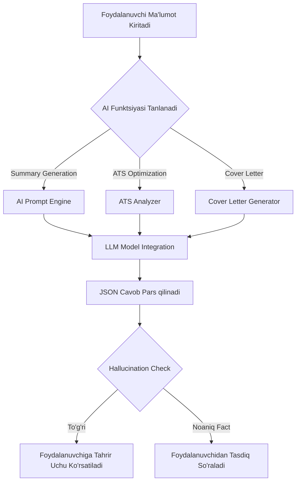
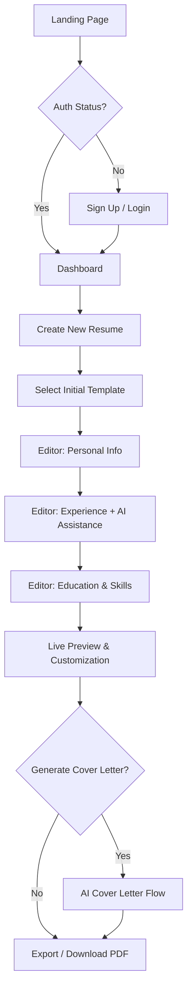
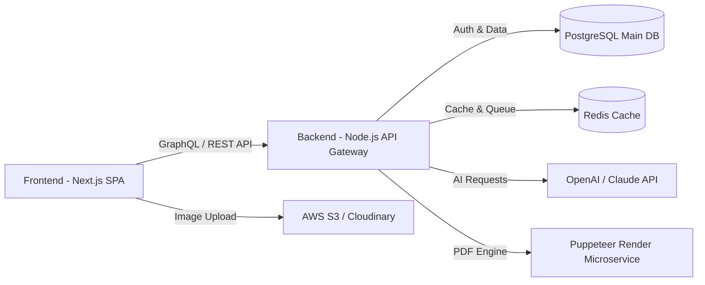
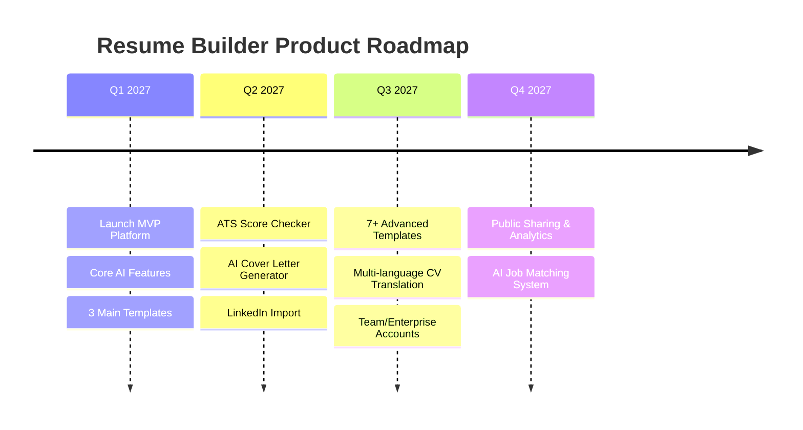

# Product Requirements Document (PRD): AI-Powered Professional Resume Builder Platform

* **Doc Status:** Approved for Development
* **Author:** Senior Product Manager
* **Target Audience:** Engineering, UI/UX Design, AI & Data Science Teams

---

## 1. Product Overview

AI-Powered Professional Resume Builder — bu foydalanuvchilarga professional rezyumelar (CV) va hamroh xatlarni (Cover Letter) tez, sifatli hamda ATS (Applicant Tracking System) talablariga to'liq mos keladigan tarzda yaratish imkonini beruvchi zamonaviy veb-platformadir. Platforma foydalanuvchi tomonidan kiritilgan oddiy va xom ma'lumotlarni boyitish, qayta ishlash hamda vizual jihatdan zamonaviy shablonlarga joylashtirish uchun ilg'or Sun'iy Intellekt (AI) texnologiyalaridan foydalanadi.

---

## 2. Product Vision and Goals

### Vision
Karyerasining har qanday bosqichidagi mutaxassislar uchun ishga joylashish jarayonini soddalashtirish, xalqaro mehnat bozori standartlariga mos va yuqori konversiyali rezyumelarni soniyalar ichida shakllantirish imkonini beruvchi yetakchi AI platformaga aylanish.

### Primary Goals
* **Vaqtni tejash:** Rezyume yaratish va formatlash vaqtini o'rtacha 2 soatdan 15 daqiqagacha qisqartirish.
* **ATS Mosligi:** Yaratilgan barcha rezyumelarning kamida 95% ATS tizimlaridan muvaffaqiyatli o'tishini ta'minlash.
* **Sifat va Professionalizm:** AI yordamida foydalanuvchilarning ish tajribasidagi natijalarini (quantifiable achievements) aniqlash va ularni ta'sirli formatda taqdim etish.
* **Ko'p funktsionallik:** Bir vaqtning o'zida ham rezyume, ham moslashtirilgan Cover Letter shakllantirish.

---

## 3. Target Audience

1. **Talabalar va Yangi Bitiruvchilar (Entry-level):** Ish tajribasi kam, lekin o'z ko'nikmalari va ta'limini to'g'ri taqdim etmoqchi bo'lganlar.
2. **Tajribali Mutaxassislar (Mid/Senior level):** Boy ish tajribasiga ega, lekin uni ixcham, ta'sirchan va ATS-friendly formatga keltirishda qiyinchilikka uchrayotganlar.
3. **Karyerasini O'zgartiruvchilar (Career Switchers):** Bir sohadan boshqa sohaga o'tayotgan va o'tkaziluvchan ko'nikmalarini (transferable skills) ta'kidlashi kerak bo'lganlar.
4. **IT va Texnik Mutaxassislar:** O'z loyihalari, texnik stack'i va ko'nikmalarini aniq strukturada ko'rsatmoqchi bo'lgan dasturchilar hamda muhandislar.

---

## 4. User Personas

### Persona 1: Jasur (Yangi Dasturchi, 22 yosh)
* **Goal:** Dasturlash kursini bitirgan, tajribasi kam. Loyihalarini va Hard Skill'larini ko'rsatuvchi zamonaviy IT-rezyume kerak.
* **Pain Point:** Tajriba bo'limini qanday to'ldirishni bilmaydi, matn yozishda grammatik xatolarga yo'l qo'yadi.
* **Solution:** AI avtomatik ravishda uning GitHub loyihalari va kurs ishlariga asoslanib professional tavsiflar (bullet points) yaratib beradi.

### Persona 2: Malika (Marketing Menejeri, 31 yosh)
* **Goal:** Xalqaro kompaniyaga senior lavozimga topshirmoqda. Rezyumesini va Cover Letter'ini tayyorlash kerak.
* **Pain Point:** Rezyumesi juda uzun (3+ sahifa) va ATS skriningidan o'tmayapti.
* **Solution:** AI optimallashtirish va takroriy jumlalarni qisqartirish orqali rezyumeni ixchamlashtiradi hamda maqsadli vakansiyaga mos hamroh xat generatsiya qiladi.

---

## 5. Functional Requirements

### 5.1. Multi-Step Data Input Form

| Bo'lim ID | Bo'lim Nomi | Maydonlar | Majburiylik | Maxsus Funktsional |
| :--- | :--- | :--- | :--- | :--- |
| **FR-1.1** | Shaxsiy Ma'lumotlar | Rasmiy Rasm, Ism-Sharif, Tug'ilgan sana, Manzil, Tel, Email, Social links (LinkedIn, GitHub, Portfolio) | Ism, Tel, Email — **Majburiy**; Boshqalar — *Ixtiyoriy* | Rasm uchun Cropper tool; Linklar uchun URL validation |
| **FR-1.2** | Kasbiy Ma'lumotlar | Lavozim/Title, Qisqacha Profil Tavsifi (Summary), Ish Tajribasi (Kompaniya, Lavozim, Sanalar, Vazifalar/Natijalar) | Lavozim, Ish Tajribasi — **Majburiy** | Dynamic Add/Remove; AI Bullet Point Generator integration |
| **FR-1.3** | Ta'lim | Muassasa nomi, Mutaxassislik, Daraja (Bachelor, Master va h.k.), Yillar, Sertifikatlar | Muassasa, Mutaxassislik — **Majburiy** | Dynamic Add/Remove |
| **FR-1.4** | Ko'nikmalar | Hard Skills, Soft Skills, Dasturiy vositalar, Xorijiy tillar (Darajasi bilan) | Hard Skills — **Majburiy** | Tag/Badge formatida kiritish; Skill Level selector (A1-C2, Beginner-Expert) |
| **FR-1.5** | Qo'shimcha | Loyihalar, Mukofotlar, Ilmiy nashrlar, Ko'ngillilik faoliyati | *Barchasi Ixtiyoriy* | Custom Section qo'shish imkoniyati |

*Eslatma: Har bir bo'lim uchun drag-and-drop orqali elementlar tartibini o'zgartirish (re-order) va o'chirish/qo'shish funksiyasi ta'minlanadi.*

---

## 6. AI Features and Requirements

AI moduli platformaning eng muhim ustunlaridan biridir. Barcha AI operatsiyalari real-vaqtda LLM API (masalan, OpenAI GPT-4o / Anthropic Claude) orqali amalga oshiriladi.



### 6.1. Avtomatik Tavsif va Natijalar Yaratish (AI Content Generator)
* **FR-2.1:** Kiritilgan kalit so'zlar yoki oddiy jumlalar (masalan: *"Menejer bo'lib ishladim, sotuvni oshirdim"*) asosida AI professional va harakatga yo'naltirilgan (Action Verb + Task + Result) bullet pointlar shakllantiradi (*"Sotuv strategiyasini qayta ko'rish orqali choraklik tushumni 25% ga oshirdim"*).
* **FR-2.2:** Profile Summary (Professional Tavsif) uchun 3 xil tonda (Professional, Impactful, Concise) avtomatik variantlar taklif qilish.

### 6.2. Kuchli Tomonlarni Aniqlash va Tahlil
* **FR-2.3:** Rezyumedagi ma'lumotlarni tahlil qilib, foydalanuvchiga uning eng kuchli 3 ta ustunligini ko'rsatish va etishmayotgan kalit so'zlarni tavsiya qilish.

### 6.3. ATS Optimallashtirish va Audit
* **FR-2.4:** Rezyume uchun ATS Score (0-100%) hisoblash.
* **FR-2.5:** Grammatika va imlo xatolarini real-vaqtda aniqlash va bir klikda tuzatish.
* **FR-2.6:** Takroriy jumlalarni aniqlab, ularni ixchamlashtirish.

### 6.4. AI Cover Letter Generator
* **FR-2.7:** Rezyume ma'lumotlari + Ish beruvchi nomi + Vakansiya matni (Job Description) kiritilganda, avtomatik ravishda moslashtirilgan Hamroh xat yaratish.
* **FR-2.8:** Tone adjustment (Formal, Enthusiastic, Confident, Direct).

### 6.5. Hallucination Guardrails (Zaruriy Cheklov!)
* **CRITICAL REQUIREMENT (AI-01):** AI hech qachon foydalanuvchi kiritmagan ish joyi, diplom, sertifikat yoki soxta ko'nikmalarni to'qib chiqarmasligi shart. AI faqat kiritilgan ma'lumot matnini shaklan va usluban boyitadi. Foydalanuvchi AI yaratgan har bir matnni qo'llashdan oldin **"Accept"** yoki **"Reject"** tugmasi orqali tasdiqlaydi.

---

## 7. UI/UX Requirements

### 7.1. Navigation and Main Pages Structure
1. **Landing Page:** Mahsulot xususiyatlari, Shablonlar preview-si, CTA ("Rezyume yaratish").
2. **Dashboard / My Resumes:** Saqlangan rezyumelar ro'yxati, yangi yaratish, dublikat qilish, o'chirish.
3. **Editor Workspace (Main Editor):** Split-screen ko'rinishi (Chapda Forma, O'ngda Real-time Live Preview).
4. **Template Gallery Modal/Page:** Shablonlarni tanlash va almashtirish.
5. **AI Cover Letter Workspace:** Rezyume bazasida hamroh xat yaratish va tahrirlash paneli.
6. **Export / Download Page:** PDF sozlamalari va yuklab olish.

### 7.2. UX Elements & Interactive Features
* **Progress Bar:** Rezyume to'liqlik darajasi (masalan: 75% to'liq).
* **Auto-Save Indicator:** "Saving...", "All changes saved to cloud".
* **Split View Toggle (Desktop):** Live preview panelini kengaytirish/yashirish.
* **Mobile UX:** Mobile ekranlarda Step-by-Step wizard ko'rinishi, "Preview" tugmasi pastki floating-bar sifatida.

---

## 8. Design System

### 8.1. Palette & Typography
* **Primary Color:** Deep Indigo (`#4F46E5`)
* **Secondary / Accent:** Emerald Green (`#10B981`)
* **Neutral Dark:** Charcoal (`#1E293B`)
* **Neutral Light:** Cool Gray (`#F8FAFC`)
* **UI Typography:** Inter, Plus Jakarta Sans
* **CV Document Fonts:** Garamond, Merriweather, Roboto, Helvetica, Montserrat, Open Sans.

### 8.2. Resume Templates (7 Core Directions)

| Shablon Turi | Maqsadi va Uslubi | Target Audience |
| :--- | :--- | :--- |
| **1. Minimalist & Modern** | Clean layout, ko'p bo'sh joy (white space), nozik chiziqlar | UI/UX Designers, General Jobs |
| **2. Classic & Formal** | An'anaviy 1-ustunli, Serif shriftlar, rasmiy | Huquqshunoslar, Moliya, Bank |
| **3. Corporate** | 2-ustunli, korporativ ko'k/kulrang ranglar | Biznes tahlilchilar, Menejerlar |
| **4. Creative** | Rangli aksentlar, zamonaviy sarlavhalar, rasm paneli | Graphic Designers, Marketing, Content Creators |
| **5. Academic / CV** | Uzoq matnlar, ilmiy nashrlar va loyihalar bo'limi ustuvor | Tadqiqotchilar, O'qituvchilar, PhD |
| **6. Tech / IT** | Dynamic code-style badges, GitHub/Tech stack bo'limi ajratilgan | Dasturchilar, DevOps, System Admin |
| **7. Executive** | Premium va oliy darajadagi ko'rinish, muhim yutuqlar tepada | C-Level Rahbarlar, VP, Directors |

---

## 9. User Flows



---

## 10. User Stories

### US-01: Auto-generating Bullet Points with AI
* **As a** foydalanuvchi,
* **I want to** o'z ish tajribamdagi oddiy vazifalar matnini AI yordamida professional jumlalarga o'g'irishni,
* **So that** ish beruvchilar va HR vakillarida kuchli taassurot qoldirish.

### US-02: Real-time Live Preview & Customization
* **As a** foydalanuvchi,
* **I want to** shaklga ma'lumot kiritganimda yoki rang/shriftni o'zgartirganimda o'ng tarafdagi rezyume varag'ida o'zgarishlarni darhol ko'rishni,
* **So that** tayyor hujjat qanday ko'rinishga ega bo meyorini nazorat qila olay.

### US-03: ATS Friendly PDF Download
* **As a** foydalanuvchi,
* **I want to** rezyumemni pixel-perfect PDF formatida yuklab olishni,
* **So that** matnlar kesilib qolmasin va ATS tizimlari matnni osongina read (parse) qila olsin.

---

## 11. Non-Functional Requirements

* **Performance:** Editor sahifasining yuklanish vaqti < 1.5 sek. Live preview rendersiyalanishi < 100ms.
* **PDF Rendering:** Backend/Frontend PDF generatsiyasi 3 soniyadan oshmasligi kerak.
* **Scalability:** Tizim bir vaqtning o'zida 10,000 active user session'larini ko'tara olishi kerak.
* **Reliability:** Auto-save mexanizmi har 3 soniyada (debounce) ishlaydi, ma'lumot yo'qolishi ehtimoli 0%.
* **Accessibility (a11y):** WCAG 2.1 AA standartlariga mos kelishi kerak.

---

## 12. Technical Architecture



* **Frontend Framework:** Next.js (React), Tailwind CSS, Zustand / Redux Toolkit (State Management).
* **Backend Framework:** Node.js (NestJS) / TypeScript.
* **Database:** PostgreSQL (Prisma ORM) — relyatsion ma'lumotlar uchun.
* **Caching & Queue:** Redis (BullMQ — PDF generatsiya navbati uchun).
* **PDF Rendering Engine:** Headless Chrome via Puppeteer (HTML/CSS to PDF convert). Matnlar rastrga (image) aylanmaydi, real vector text bo'lib qoladi (ATS readablity uchun).
* **File Storage:** AWS S3 (Profil rasmlari uchun).

---

## 13. Data Model

### Database Schema Overview (Entity Relationship Diagram Structure)

```
[Users] 1 --- * [Resumes]
[Resumes] 1 --- * [Experiences]
[Resumes] 1 --- * [Educations]
[Resumes] 1 --- * [Skills]
[Resumes] 1 --- 1 [StylingSettings]
[Resumes] 1 --- * [CoverLetters]
```

#### Table: `resumes`
* `id` (UUID, Primary Key)
* `user_id` (UUID, Foreign Key -> `users.id`)
* `title` (VarChar) — Masalan: "Fullstack Developer Resume"
* `personal_info` (JSONB) — `{ fullName, email, phone, photoUrl, location, links: [] }`
* `template_id` (VarChar) — Masalan: "modern-minimal-01"
* `created_at`, `updated_at` (Timestamp)

#### Table: `experiences`
* `id` (UUID)
* `resume_id` (UUID, FK -> `resumes.id`)
* `company_name` (VarChar)
* `position` (VarChar)
* `start_date` (Date)
* `end_date` (Date, Nullable if current)
* `is_current` (Boolean)
* `description_bullets` (JSONB / Array of strings)

---

## 14. API Requirements

### 14.1. Key REST Endpoints

```
POST   /api/v1/resumes               # Yangi rezyume yaratish
GET    /api/v1/resumes               # Foydalanuvchining barcha rezyumelari
GET    /api/v1/resumes/:id           # Rezyume tafsilotlarini olish
PUT    /api/v1/resumes/:id           # Rezyumeni yangilash (Auto-save)
POST   /api/v1/ai/generate-bullets    # AI Bullet point generatsiyasi
POST   /api/v1/ai/optimize-summary   # AI Profile Summary tayyorlash
POST   /api/v1/ai/cover-letter       # Cover Letter yaratish
POST   /api/v1/export/pdf            # HTML to PDF konvertatsiya
```

---

## 15. Security and Privacy

* **Data Encryption:** Barcha tranzit ma'lumotlar HTTPS/TLS 1.3 orqali shifrlanadi. Baza ma'lumotlari AES-256 bilan saqlanadi.
* **API Security:** Rate limiting (e.g., AI so'rovlari uchun 1 daqiqada max 20 so'rov per user). API kalitlari (OpenAI) faqat Server-Side saqlanadi.
* **Data Retention & Privacy (GDPR):** Foydalanuvchi "Delete Account" tugmasini bossa, uning barcha rezyumelari, rasmlari va shaxsiy ma'lumotlari ma'lumotlar bazasidan butunlay (Hard Delete) o'chiriladi.
* **AI Privacy:** AI API-ga yuboriladigan so'rovlarda foydalanuvchining nozik ma'lumotlari (Passpor ID, Parol va h.k.) filtrlanadi va modelni treyning qilish uchun ishlatilmaslik bayrog'i (`opt-out`) o'rnatiladi.

---

## 16. MVP Scope

### Included in MVP (Minimum Viable Product)
* Email va Google OAuth orqali ro'yxatdan o'tish.
* Multi-step Form (Shaxsiy, Tajriba, Ta'lim, Ko'nikmalar).
* 3 ta asosiy dizayn shablon (Minimalist, Classic, Modern Tech).
* Asosiy AI imkoniyatlari: Bullet point generator, Summary improver.
* Real-time Live Preview (Desktop va Mobile).
* Puppeteer orqali sifatli PDF yuklab olish.
* AI Cover Letter generator (Basic version).

---

## 17. Prioritization (P0 / P1 / P2)

```mermaid
quadrantChart
    title Feature Prioritization Matrix
    x-axis Low Technical Effort --> High Technical Effort
    y-axis Low User Value --> High User Value
    quadrant-1 P1: High Value & High Effort
    quadrant-2 P0: High Value & Low Effort
    quadrant-3 P2: Low Value & Low Effort
    quadrant-4 P1/P2: Low Value & High Effort
    "Multi-step Form": [0.2, 0.95]
    "Live Preview": [0.35, 0.9]
    "PDF Export": [0.3, 0.85]
    "AI Bullet Point Gen": [0.4, 0.88]
    "AI Cover Letter": [0.65, 0.8]
    "Custom Layout Drag-Drop": [0.75, 0.5]
    "LinkedIn Data Import": [0.8, 0.6]
    "Multi-language CV Translate": [0.85, 0.45]
```

* **P0 (Must-Have for Launch / MVP):**
  * Form Data Input + Validation.
  * 3 Core Templates.
  * Real-time Preview.
  * PDF Export engine.
  * AI Summary & Experience Enhancer.
  * Auto-save.

* **P1 (High Priority - Post MVP):**
  * AI Cover Letter Generator.
  * 4 ta yangi shablon (Executive, Academic, Creative, Corporate).
  * ATS Compatibility Score Check.
  * LinkedIn profildan avtomatik ma'lumotlarni import qilish.

* **P2 (Nice to Have - Future):**
  * Ko'p tilli rezyumelarni AI yordamida bir klikda tarjima qilish (Multilingual Translation).
  * Video Resume introduction funksiyasi.
  * Analytics dashboard (Rezyume necha marta ko'rilganini kuzatish uchun public link share).

---

## 18. Acceptance Criteria

### AC-01: PDF Export Quality & Formatting
* **Given:** Foydalanuvchi rezyume to'ldirishni tugatdi va "Download PDF" tugmasini bosdi.
* **When:** PDF fayl generatsiya bo'lganda.
* **Then:** 
  1. Hujjat aniq A4 sahifa o'lchamida bo'lishi kerak.
  2. Sahifa chegaralarida matnlar kesilib qolmasligi lozim (Page-break rules to'g'ri ishlashi shart).
  3. Matnlar rasmga aylanmagan, sichqoncha bilan belgilab bo'ladigan (selectable vector text) bo'lishi shart.

### AC-02: AI Hallucination Guard
* **Given:** Foydalanuvchi ish tajribasiga "Sotuvchi" deb yozgan.
* **When:** AI "Enhance Description" funksiyasini bajarganda.
* **Then:** AI hech qachon "Men Garvard universitetini bitirganman" kabi foydalanuvchi bermagan ma'lumotni matnga qo'shmasligi va foydalanuvchiga tasdiqlash uchun ko'rsatishi shart.

---

## 19. Edge Cases and Error Handling

| Edge Case | Ehtimoliy Muammo | Yechim / Error Handling |
| :--- | :--- | :--- |
| **Juda uzoq matn kiritilishi** | Foydalanuvchi 5 sahifalik matn kiritib yuboradi | UI-da xabarnoma ko'rsatiladi: *"Professional rezyumelar 1-2 sahifadan oshmasligi tavsiya etiladi"*. Live preview-da 2-sahifadan o'tgan joyi vizual ajratib ko'rsatiladi. |
| **AI API Timeout / Error** | OpenAI API sekinlashsa yoki ishlamasa | Fallback UI: *"AI xizmati vaqtincha band. Iltimos, bir ozdan keyin qayta urining"*. Foydalanuvchi ma'lumoti yo'qolmaydi. |
| **Internet uzilib qolishi** | Auto-save ishlamay qolishi mumkin | Offline indicator va LocalStorage-da vaqtinchalik backup saqlash. Internet tiklangach synch qilish. |
| **Yuqori hajmli rasm yuklash** | 15MB+ o'lchamdagi rasm yuklanishi | Frontend client-side image compression (max 2MB ga kichraytirish) va o'lcham/format check (JPG, PNG, WEBP). |

---

## 20. Future Roadmap



---

## 21. Success Metrics (KPIs)

1. **Conversion Rate (Funnel):** Landing page-ga kirgan foydalanuvchilarning kamida 15%i rezyume yaratishni boshlashi.
2. **Completion Rate:** Rezyume yaratishni boshlaganlarning 70%dan ortig'i PDF formatida yuklab olish bosqichiga etib borishi.
3. **AI Feature Adoption:** Foydalanuvchilarning kamida 60%i rezyume yaratish davomida kamida 1 marta AI funksiyalaridan foydalanishi.
4. **User Satisfaction (CSAT):** Hujjatni yuklab olgandan keyingi so'rovnomada 4.5/5 rating ko'rsatkichi.