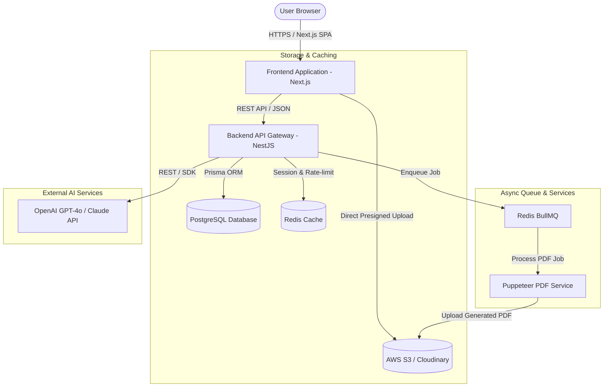
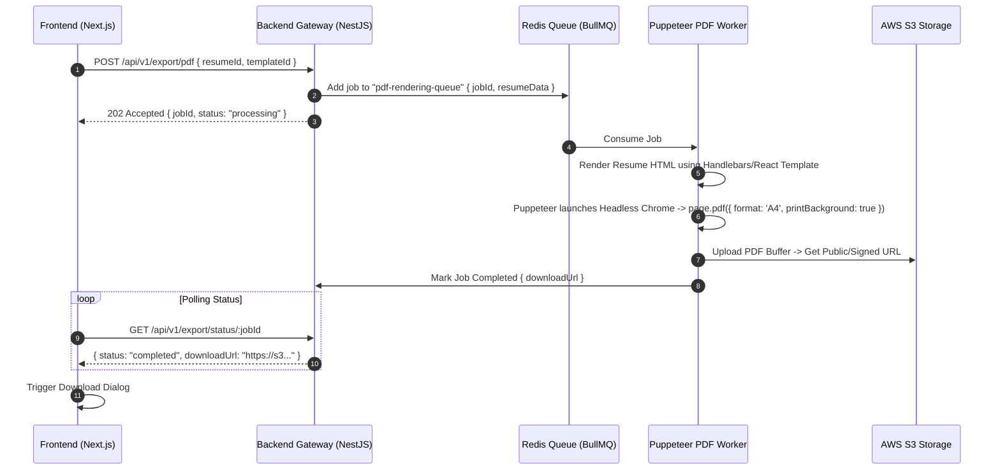

# Technical Specification (SPEC): AI-Powered Professional Resume Builder Platform

* **Document Version:** 1.0.0
* **Status:** Ready for Engineering Review
* **Target Audience:** Frontend, Backend, AI/ML Engine, and Infrastructure Engineers

---

## 1. System Overview & Architecture Diagram

Ushtbu tizim microservices/modular monolith yondashuviga asoslangan bo'lib, Next.js SPA (Frontend), NestJS Node.js API Gateway (Backend), PostgreSQL (Main DB), Redis (Queue/Caching), Puppeteer Microservice (PDF Engine), hamda LLM Provider (OpenAI/Claude) o'rtasidagi o'zaro aloqani ta'minlaydi.

### System Architecture Diagram



---

## 2. Tech Stack & Infrastructure

| Layer | Technology Chosen | Purpose / Justification |
| :--- | :--- | :--- |
| **Frontend Framework** | **Next.js 14+ (App Router)** | SSR/SSG capabilities, React 18 Concurrent mode, SEO for Landing pages |
| **State Management** | **Zustand + Immer** | Lightweight, high-performance state management for complex form & real-time preview sync |
| **Styling & UI Components**| **Tailwind CSS + Shadcn UI** | Utility-first CSS, responsive styling, Accessible UI primitives |
| **Backend Framework** | **NestJS (TypeScript)** | Enterprise-grade architecture, dependency injection, strong TypeScript support |
| **Database & ORM** | **PostgreSQL 16 + Prisma ORM** | Relational integrity, JSONB support for dynamic resume blocks, type-safe queries |
| **Caching & Job Queue** | **Redis 7.x + BullMQ** | Fast in-memory caching, rate limiting, asynchronous background PDF processing |
| **PDF Rendering Service** | **Puppeteer (Chromium)** | High-fidelity HTML/CSS-to-PDF engine with full page-break control and vector text preservation |
| **Object Storage** | **AWS S3 / Cloudinary** | Secure media/photo storage with presigned URLs |
| **Authentication** | **NextAuth.js / Passport.js** | JWT access tokens with Refresh Tokens, Google OAuth 2.0 integration |
| **AI LLM Engine** | **OpenAI API (`gpt-4o-mini` & `gpt-4o`)** | Fast inference for real-time text enhancement and structured JSON outputs |

---

## 3. Detailed Data Schemas (PostgreSQL / Prisma)

```prisma
// prisma/schema.prisma

datasource db {
  provider = "postgresql"
  url      = env("DATABASE_URL")
}

generator client {
  provider = "prisma-client-js"
}

model User {
  id            String         @id @default(uuid())
  email         String         @unique
  passwordHash  String?        // Nullable for OAuth users
  fullName      String
  avatarUrl     String?
  provider      AuthProvider   @default(EMAIL)
  resumes       Resume[]
  coverLetters  CoverLetter[]
  createdAt     DateTime       @default(now())
  updatedAt     DateTime       @updatedAt

  @@map("users")
}

enum AuthProvider {
  EMAIL
  GOOGLE
}

model Resume {
  id             String          @id @default(uuid())
  userId         String
  user           User            @relation(fields: [userId], references: [id], onDelete: Cascade)
  title          String          @default("Untitled Resume")
  templateId     String          @default("minimal-modern-01")
  
  // Customization Settings
  typography     String          @default("Inter")
  primaryColor   String          @default("#4F46E5")
  fontSize       FontSize        @default(MEDIUM)
  spacing        Spacing         @default(NORMAL)

  // Sections Data
  personalInfo   PersonalInfo?
  experiences    Experience[]
  educations     Education[]
  skills         Skill[]
  customSections CustomSection[]

  atsScore       Int?
  createdAt      DateTime        @default(now())
  updatedAt      DateTime        @updatedAt

  coverLetters   CoverLetter[]

  @@map("resumes")
}

enum FontSize {
  SMALL
  MEDIUM
  LARGE
}

enum Spacing {
  COMPACT
  NORMAL
  SPACIOUS
}

model PersonalInfo {
  id          String   @id @default(uuid())
  resumeId    String   @unique
  resume      Resume   @relation(fields: [resumeId], references: [id], onDelete: Cascade)
  fullName    String
  jobTitle    String
  email       String
  phone       String?
  location    String?
  photoUrl    String?
  summary     String?  @db.Text
  links       Json?    // Array of { label: string, url: string }
}

model Experience {
  id          String    @id @default(uuid())
  resumeId    String
  resume      Resume    @relation(fields: [resumeId], references: [id], onDelete: Cascade)
  company     String
  position    String
  location    String?
  startDate   DateTime
  endDate     DateTime?
  isCurrent   Boolean   @default(false)
  bullets     String[]  // Array of bullet points
  orderIndex  Int       @default(0)
}

model Education {
  id          String    @id @default(uuid())
  resumeId    String
  resume      Resume    @relation(fields: [resumeId], references: [id], onDelete: Cascade)
  institution String
  degree      String
  fieldOfStudy String?
  startDate   DateTime
  endDate     DateTime?
  isCurrent   Boolean   @default(false)
  description String?   @db.Text
  orderIndex  Int       @default(0)
}

model Skill {
  id          String    @id @default(uuid())
  resumeId    String
  resume      Resume    @relation(fields: [resumeId], references: [id], onDelete: Cascade)
  name        String
  category    SkillCategory @default(HARD)
  level       SkillLevel?
}

enum SkillCategory {
  HARD
  SOFT
  LANGUAGE
  TOOL
}

enum SkillLevel {
  BEGINNER
  INTERMEDIATE
  ADVANCED
  EXPERT
}

model CustomSection {
  id          String   @id @default(uuid())
  resumeId    String
  resume      Resume   @relation(fields: [resumeId], references: [id], onDelete: Cascade)
  sectionName String
  items       Json     // Array of { title: string, subtitle: string, date: string, description: string }
  orderIndex  Int      @default(0)
}

model CoverLetter {
  id          String   @id @default(uuid())
  userId      String
  user        User     @relation(fields: [userId], references: [id], onDelete: Cascade)
  resumeId    String?
  resume      Resume?  @relation(fields: [resumeId], references: [id], onDelete: SetNull)
  companyName String
  jobTitle    String
  jobDesc     String?  @db.Text
  tone        String   @default("professional")
  content     String   @db.Text
  createdAt   DateTime @default(now())
  updatedAt   DateTime @updatedAt

  @@map("cover_letters")
}
```

---

## 4. API Specification & Endpoints

### 4.1. Resume Management APIs

#### `POST /api/v1/resumes`
Yangi rezyume obyektini yaratadi.
* **Headers:** `Authorization: Bearer <token>`
* **Request Body:**
```json
{
  "title": "Software Engineer 2027",
  "templateId": "tech-it-01"
}
```
* **Response (201 Created):**
```json
{
  "id": "c39a2b8e-7e1d-4b90-972d-8e4d2a1041ab",
  "title": "Software Engineer 2027",
  "templateId": "tech-it-01",
  "createdAt": "2027-01-15T08:00:00.000Z"
}
```

#### `PUT /api/v1/resumes/:id` (Debounced Auto-save)
Rezyume ma'lumotlarini qisman yoki to'liq yangilaydi.
* **Headers:** `Authorization: Bearer <token>`
* **Request Body:**
```json
{
  "typography": "Roboto",
  "primaryColor": "#10B981",
  "personalInfo": {
    "fullName": "Jasur Rahimov",
    "jobTitle": "Full Stack Developer",
    "email": "jasur@example.com",
    "summary": "Passionate developer with 3+ years experience..."
  }
}
```
* **Response (200 OK):** `{ "success": true, "updatedAt": "2027-01-15T08:05:12.000Z" }`

---

### 4.2. AI Engine APIs

#### `POST /api/v1/ai/enhance-bullet`
Oddiy ish vazifasi matnini professional va natijaga yo'naltirilgan ta'sirli bullet point ga o'zgartiradi.
* **Request Body:**
```json
{
  "rawText": "Menejer bo'lib ishladim va sotuvni oshirdim",
  "jobTitle": "Sales Manager",
  "tone": "Impactful"
}
```
* **Response (200 OK):**
```json
{
  "suggestions": [
    "Sotuv strategiyalarini optimallashtirish va mijozlar bazasini kengaytirish orqali oylik tushumni 25% ga oshirdim.",
    "B2B sotuvlar jarayonini qayta ko'rib chiqib, umumiy bitimlar sonini choraklik 40+ taga yetkazdim."
  ]
}
```

#### `POST /api/v1/ai/generate-cover-letter`
Rezyume va vakansiya tavsifi asosida moslashtirilgan Cover Letter tayyorlaydi.
* **Request Body:**
```json
{
  "resumeId": "c39a2b8e-7e1d-4b90-972d-8e4d2a1041ab",
  "companyName": "TechCorp Global",
  "jobTitle": "Senior React Developer",
  "jobDescription": "We are looking for a Senior React Developer proficient in Next.js, TypeScript, and state management...",
  "tone": "confident"
}
```
* **Response (200 OK):**
```json
{
  "coverLetterId": "f82b1a90-3c4d-4e5f-a6b7-8c9d0e1f2a3b",
  "content": "Dear Hiring Team at TechCorp Global,\n\nI am writing to express my strong interest in the Senior React Developer position..."
}
```

---

## 5. AI Prompt Engineering & Guardrails Integration

LLM integratsiyasida to'qib chiqarilgan soxta ma'lumotlar (hallucinations) oldini olish uchun Structured Output (JSON Schema Mode) va qat'iy System Prompt cheklovlaridan foydalaniladi.

### System Prompt for Experience Enhancer

```text
SYSTEM PROMPT:
You are an expert ATS Optimization Coach and Executive Resume Writer.
Your task is to rewrite the user's provided job experience text into professional, high-impact bullet points.

CRITICAL CONSTRAINTS & GUARDRAILS:
1. DO NOT fabricate any fake companies, degrees, certifications, or false metrics not mentioned or implied by the user.
2. Maintain absolute truthfulness to the user's input facts.
3. Every generated bullet point MUST start with a strong Action Verb (e.g., Developed, Spearheaded, Accelerated).
4. Output MUST be valid JSON conforming strictly to the provided JSON Schema.
5. If the input is too vague, generate 2-3 realistic variations incorporating placeholders like [X%] or [X amount] for the user to fill in.

JSON SCHEMA OUTPUT:
{
  "type": "object",
  "properties": {
    "suggestions": {
      "type": "array",
      "items": { "type": "string" }
    }
  },
  "required": ["suggestions"]
}
```

---

## 6. PDF Rendering Architecture (Puppeteer Microservice)

Matnlar rastrga (PNG/JPG) aylanib qolmasligi, ATS qidiruv tizimlari va PDF ko'chiruvchilar matnni osongina ajrata olishi uchun HTML/CSS Puppeteer yordamida to'g'ridan-to'g'ri PDF faylga o'giriladi.



### Page-Break CSS Implementation Rules
Multi-page PDF-da kontent varaq o'rtasida noo'rin bo'linib qolmasligi uchun quyidagi CSS print-media qoidalari majburiydir:

```css
/* Styling injected during Puppeteer rendering */
@page {
  size: A4 portrait;
  margin: 0;
}

body {
  -webkit-print-color-adjust: exact;
  print-color-adjust: exact;
}

.resume-section-item {
  page-break-inside: avoid;
  break-inside: avoid;
}

h1, h2, h3 {
  page-break-after: avoid;
  break-after: avoid;
}

.page-break {
  page-break-before: always;
  break-before: always;
}
```

---

## 7. Frontend State Management & Real-time Live Preview

Frontend ilovasi kiritilgan ma'lumotlarning darhol o'ng tomondagi Preview oynasida aks etishini ta'minlash uchun **Zustand** bilan **Immer** middleware-dan foydalanadi.

```typescript
// store/useResumeStore.ts
import { create } from 'zustand';
import { produce } from 'immer';

interface ResumeState {
  resumeData: ResumeModel;
  isSaving: boolean;
  updatePersonalInfo: (info: Partial<PersonalInfoModel>) => void;
  addExperience: (exp: ExperienceModel) => void;
  debouncedSave: () => void;
}

export const useResumeStore = create<ResumeState>((set, get) => ({
  resumeData: initialResumeState,
  isSaving: false,

  updatePersonalInfo: (info) =>
    set(
      produce((state: ResumeState) => {
        state.resumeData.personalInfo = { ...state.resumeData.personalInfo, ...info };
      })
    ),

  addExperience: (exp) =>
    set(
      produce((state: ResumeState) => {
        state.resumeData.experiences.push(exp);
      })
    ),

  debouncedSave: debounce(async () => {
    set({ isSaving: true });
    const currentData = get().resumeData;
    await fetch(`/api/v1/resumes/${currentData.id}`, {
      method: 'PUT',
      headers: { 'Content-Type': 'application/json' },
      body: JSON.stringify(currentData),
    });
    set({ isSaving: false });
  }, 1500),
}));
```

---

## 8. Security, Rate Limiting, & Error Handling

### 8.1. Rate Limiting Strategy
* **Auth & User APIs:** Redis Store orqali IP bo'yicha max **100 req/min**.
* **AI Generation APIs:** User Token bo'yicha max **15 req/min** (LLM xarajatlarini nazorat qilish va abuse-ni oldini olish uchun).
* **PDF Export API:** User Token bo'yicha max **5 req/min**.

### 8.2. Error Handling & Standard API Responses

Barcha API javoblari standart JSON shaklida bo'ladi:

```json
{
  "statusCode": 429,
  "error": "Too Many Requests",
  "message": "AI generation limit exceeded. Please wait 60 seconds before trying again.",
  "timestamp": "2027-01-15T08:12:00.000Z",
  "path": "/api/v1/ai/enhance-bullet"
}
```

### 8.3. Security Checklist
* **XSS Sanitization:** React `dangerouslySetInnerHTML` faqat HTML-sanitized (DOMPurify) matnlar uchun ishlatiladi.
* **Presigned URLs:** Rasmlar AWS S3 ga to'g'ridan-to'g'ri yuklanadi. Backend faqat 5 daqiqa amal qiluvchi Presigned PUT URL taqdim etadi.
* **LLM Opt-Out:** OpenAI API-ga yuboriladigan barcha so'rovlarda `store: false` bayrog'i o'rnatiladi, foydalanuvchi ma'lumotlari modelni qayta o'qitish (training) uchun ishlatilmaydi.